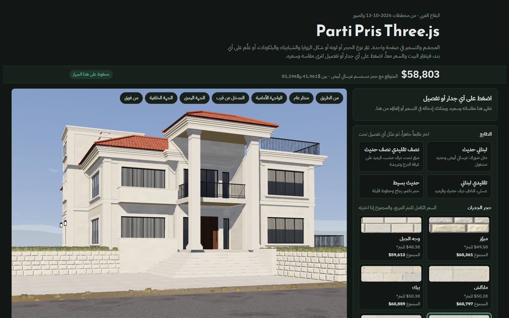

# architectural-three.js

A study-and-rebuild workspace for **Parti Pris** — a single-file, procedural
Three.js architectural visualiser that draws a measured Lebanese stone villa
detail by detail, prices the stone, and renders photographs of it.

This repository is **not** the reference app and does not ship it. It freezes the
reference, measures it, teaches the Three.js needed to reproduce it, and then
rebuilds the techniques in original code.

## Output contract

**The built app must be one single, self-contained `.html` file.** HTML, CSS,
JavaScript, Three.js and the model data are inlined; there is no runtime CDN, no
runtime network request of any kind (including web fonts), no separate
JS/CSS/image asset, and no server-side code. Inline media uses `data:` URLs;
`srcset` is rejected. Authoring can use Vite +
`vite-plugin-singlefile`, but the release artefact stays one file. This is
non-negotiable — see [`docs/decisions/0001-single-file.md`](docs/decisions/0001-single-file.md).



## Status

| Phase | State |
| --- | --- |
| Reference frozen + integrity enforced | done |
| Repository foundation, licence, dev server, tests | done |
| Three.js mastery track (modules 1–8) | curriculum + labs 1–3 passing (Gate D) |
| Deep teardown | `docs/analysis/parti-pris-teardown.md` |
| Targets + render architecture | `docs/targets.md`, `docs/decisions/` |
| Phase 4 app shell | Vite 8 + singlefile scaffold, schema validator, build gate |
| M1 wall graph | v2 validator + 74-wall / 57-opening reference round-trip |
| M2 DXF import | LINE / straight LWPOLYLINE walls + explicit sidecar openings |

## The reference at a glance

| Property | Value |
| --- | --- |
| File | `reference/parti-pris-three.js.html` — byte-immutable |
| Size | 960,097 bytes, 4,064 lines, LF only |
| SHA-256 | `e1f2a511…f30a4cf5` (see `reference/SHA256SUMS`) |
| Engine | Three.js **r128** + OrbitControls, both MIT, inlined |
| External assets | **none bundled** — no GLB, glTF, HDRI, image textures or CDN scripts; the reference may load Google Fonts at runtime |
| App script | 2,479 lines, 246 functions (after the inlined engine) |
| Model | 3 floors · 74 named walls · 57 openings (43 windows, 14 doors) · 8 balconies · 12-vertex roof · stair room · terrace · 8 steps |
| Cost model | 37 priced items · 8 stone finishes · 4 sections |
| Rendering | GPU stone generator, AO accumulation + camera jitter, bloom/grade |
| Fonts | Reference: Google Fonts at runtime. Rebuild: system fonts only, no network. |

The model is a **surveyed digital twin**, not a generated massing: every wall has
an Arabic room name, every opening has absolute coordinates and a sill height,
and `model.check` reconciles computed areas against a separate workbook to
within 2 m².

## Quick start

Requirements: **Node 22.12+** (Vite 8), a browser with WebGL2.

```bash
npm install
npm run serve
# reference: http://127.0.0.1:8080/reference/parti-pris-three.js.html
```

`scripts/serve.mjs` is a zero-dependency static server. No `npx`, no network, no
framework. `PORT=9000 npm run serve` changes the port.

```bash
npm test               # reference, schema, import and build-gate assertions
npm run verify:reference
npm run verify:model   # reference model → v2 → round-trip
npm run labs           # three.js labs 1–3 (needs `npm install` once)
npm run dev            # shell at http://127.0.0.1:5173
npm run build          # dist/index.html; fails unless exactly one self-contained file
```

## Repository map

```
app/
  index.html                 Phase 4 shell entry
  src/schema.js              canonical v2 wall-graph validator
  src/model/import.js        legacy reference → v2 round-trip
  src/model/dxf.js           DXF walls + explicit opening attachment
  src/components/            empty component-library boundary
  src/                       shell UI + styles
vite.config.js               Vite 8 + vite-plugin-singlefile
scripts/check-build.mjs      one-file / no-external-assets build gate
reference/
  parti-pris-three.js.html   frozen reference — never edited
  SHA256SUMS                 the hash that is enforced
docs/
  analysis/parti-pris-teardown.md   how the reference is built (evidence-backed)
  analysis/evidence/                extracted schema + counted inventory
  targets.md                       measurable fidelity and performance targets
  decisions/                       architecture decision records
  threejs/                         8-module mastery curriculum
  assets/                          reference screenshots
labs/
  01-core/ 02-wall-holes/ 03-window/   proof labs with assertions
scripts/serve.mjs            zero-dependency static server
tests/                       node:test integrity, model, schema + build-gate tests
```

## Reference policy

The reference file is **read-only**. Its bytes, line endings and hash are
enforced by tests; renaming is allowed, editing is not. Full policy:
[`reference/README.md`](reference/README.md).

## Licence — noncommercial only

Original work in this repository is licensed under the **PolyForm Noncommercial
License 1.0.0**. You may study, run, modify and share it for any noncommercial
purpose. **Commercial use requires a separate written licence from the author.**

Two honest caveats:

- The repository was MIT-licensed before this change. Relicensing does not and
  cannot revoke rights already granted to anyone who obtained a copy under MIT.
- The inlined Three.js r128 and OrbitControls remain **MIT** and are *not*
  restricted by the noncommercial terms. Their notices are preserved in
  [`THIRD-PARTY-NOTICES.md`](THIRD-PARTY-NOTICES.md). The reference loads Google Fonts at runtime;
  those fonts are SIL OFL 1.1 and are not redistributed here. The rebuild does
  not load them.

This is a source-available licence, not an OSI open-source licence. If you need
"no commercial use and no rights to the source at all", that is a proprietary
EULA, not PolyForm.

## Credits

Reference application and architectural study: **Ghazi Omairi**.
Engine: [Three.js](https://github.com/mrdoob/three.js) r128, MIT.
